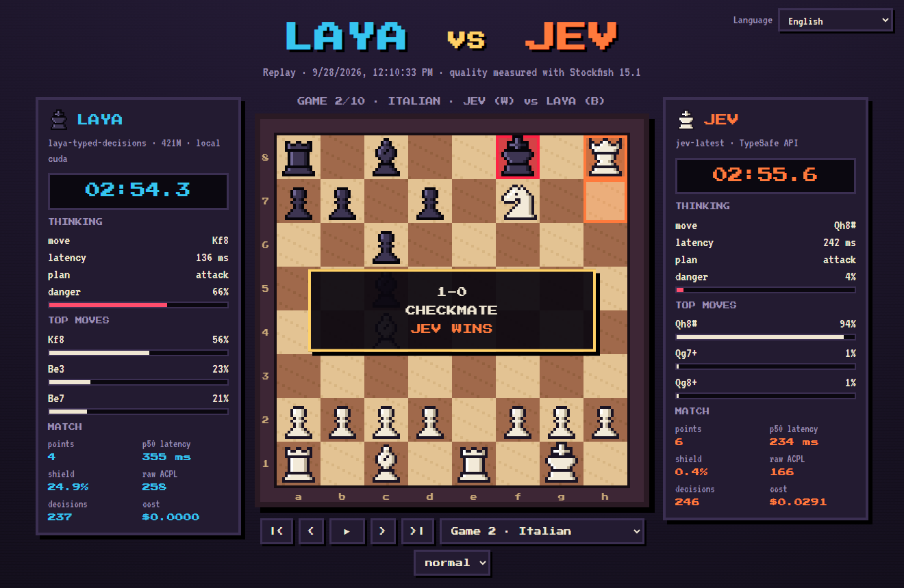

# ♞ Chess War · Laya vs Jev

**English** · [Español](i18n/README.es.md) · [Français](i18n/README.fr.md) · [Русский](i18n/README.ru.md) · [中文](i18n/README.zh-CN.md) · [한국어](i18n/README.ko.md) · [日本語](i18n/README.ja.md) · [Português](i18n/README.pt-BR.md) · [Deutsch](i18n/README.de.md) · [Italiano](i18n/README.it.md)

Pixel-art chess between two **System One** decision models that receive **the exact same typed questions**, turn after turn. Inspired by [doom-war](https://github.com/rythmn1111/doom-war), which pitted the same two models against each other in Doom.

**▶ Watch the replays (10 languages): https://jhonsu01.github.io/chess-war/**



| | **Laya** | **Jev** |
| --- | --- | --- |
| Kind | open weights (Apache 2.0) | hosted API |
| Model | `laya-typed-decisions` · ModernBERT-large, 421M | `jev-1.13.0` |
| Runs on | local Docker container, NVIDIA GPU | `api.typesafe.ai` |
| Price | $0 | $0.042 per million input tokens |

## Results

Updated automatically by `chess-war publish`. Latency, shield and ACPL are shown as *Laya / Jev* (lower is better).

<!-- RESULTS:START -->
| Date | Match | Points | p50 latency | Shield (OVERRIDDEN) | Raw ACPL | Cost | Replay |
| --- | --- | --- | --- | --- | --- | --- | --- |
| 2026-09-28 | LAYA vs JEV | **4 – 6** | 355 ms / 234 ms | 24.9% / 0.4% | 258 / 166 | $0.0291 | [watch](https://jhonsu01.github.io/chess-war/?m=20260928-171033-laya-vs-jev&lang=en) |
<!-- RESULTS:END -->

### First match · 2026-09-28

- **Jev won 6–4** over 10 games: 2 wins by checkmate, 8 draws, no losses. Laya did not win a game.
- **Jev was faster**, even over the internet: p50 234 ms vs 355 ms for Laya on the local GPU. Each turn asks ~15 questions and Laya runs one encoder pass per question.
- **Judgment:** the shield had to correct 24.9% of Laya's moves and 0.4% of Jev's. Raw ACPL (Stockfish depth 12): Laya 258, Jev 166; blunders of 300+ cp: 63 vs 38.
- **Cost:** Jev spent $0.029 on 694k input tokens; Laya ran for free.
- **8 of 10 games ended in threefold repetition:** both models are deterministic and repeat positions when nobody wins material. Laya also kept walking its king in the opening despite the `bad` label.

## How it works

```
board ─► observe.py ─► schema.py ─────────► model ─► motor.py ─────────────► move
         captures,     typed questions,     Laya     joint decoding
         hanging       SAME body for both   or Jev   + deterministic shield
         pieces, mate  (POST /v1/systemone)
         (code)        (code)                        (code)
```

- **Code does the maths, the model judges.** Each turn `observe.py` runs a static exchange evaluation two plies deep and detects mate-in-one threats. The options already state in words what the calculation knows: `good, wins a rook`, `terrible, rival can checkmate you`, `bad, king gives up castling`.
- **One request per turn** using TypeSafe's *speculative fan-out*: one `piece` question, one `move_<square>` question per movable piece, plus `plan` and `danger`. The rules of play go in the `instructions`. Only legal moves are ever offered, so the chess rules cannot be broken.
- **Same wire, same bytes.** Laya is served by `laya-serve`, which speaks the same `POST /v1/systemone` protocol as Jev. Only the URL changes.
- **The move played** is the one the model itself finds most likely: `argmax P(piece) × P(destination | piece)`.
- **Shield.** A deterministic layer vetoes only what code knows is a mistake: allowing mate in one, giving away material, or throwing a won position into a draw. It then plays the *same model's* next most likely sound move. The share of corrected moves is published as **OVERRIDDEN %**, as in doom-war.
- **Clock.** 180 s per player, charged with the full round trip (network included), so speed matters.
- **Fairness.** 10 fixed openings, each played twice with colours swapped. After 240 plies a game is adjudicated on material (a lead of 3 or more points wins).
- **Quality.** After every game Stockfish measures the centipawn loss of the move each model *chose* (raw ACPL, before the shield) and of the move actually played.

## Calibration before the match

Ten test positions with a known answer (`chess-war probe laya|jev`). The probe also shaped the design.

| Player | Score | Typical latency |
| --- | --- | --- |
| Jev `jev-1.13.0` | **10/10** | ~220 ms (over the internet) |
| Laya `typed-decisions` | **7/10** | ~400 ms (local RTX 3050) |

What the probe taught us:

1. **Literal reading.** An option said `can win the queen` for a promotion; both models read it literally (there was no queen to win). It now says `good, promotes to a queen`.
2. **Missing threat.** Neither model defended against a mate threat that was not written in the state. The state now says `the rival threatens checkmate next move`.
3. **The word "king".** Laya gave 0.86 to `king on e8: bad: …` even though it said *bad*. Removing the piece name from the options cut that bias from 0.56 to 0.09.
4. **Greedy vs joint decoding.** Choosing the piece first and then its square favoured pieces with many moves. Joint decoding fixed promotion and mate-defence cases for **both** models.
5. **Checkpoints.** Among Laya's three checkpoints, `typed-decisions` scored best (the multilingual one was the fastest but the least accurate).

## Quick start (Docker)

You need Docker Desktop with NVIDIA GPU support (CPU also works, just slower) and a TypeSafe API key.

```bash
git clone https://github.com/jhonsu01/chess-war.git
cd chess-war
cp .env.example .env        # put your key in TYPESAFE_API_KEY=
docker compose up -d --wait laya
docker compose run --rm --service-ports arena match --games 10 --exit
```

Open **http://localhost:8080/?live** to watch the match live. Results land in `results/<match-id>/` (`match.json`, `games.pgn`, `telemetry.jsonl`, `replay.json`).

**Where does the API key go?** In `.env`, as `TYPESAFE_API_KEY=...` (or in a `jev.txt` file that contains only the key). Both files are git-ignored.

Publish a match to GitHub Pages and to every README:

```bash
chess-war publish results/<match-id>
git add docs README.md i18n && git commit -m "Publish match" && git push
```

## Native run (no Docker for the arena)

```bash
uv venv --python 3.12 && uv pip install -e ".[dev]"
chess-war check                 # checks Laya and Jev (keys, reachability, one test decision)
chess-war probe laya            # the 10 calibration positions
chess-war match --games 10 --open
```

Stockfish is optional natively (`--stockfish PATH` or `STOCKFISH_PATH`); without it the ACPL is skipped.

| Command / flag | What it does |
| --- | --- |
| `match --p1 laya --p2 jev` | players: `laya`, `jev`, `lmstudio`, `random` |
| `--games 10` | number of games (pairs with colours swapped) |
| `--clock 180` | seconds per player; `0` disables the clock |
| `--no-shield` | disables the deterministic shield |
| `--max-plies 240` | ply cap before material adjudication |
| `--laya-checkpoint` | `english`, `multilingual` or `typed-decisions` |
| `--publish` | copies the result to `docs/` and updates the READMEs |
| `view` | serves `docs/` locally to browse replays |

## Optional third player: LM Studio

A generative LLM can answer the same typed questions through LM Studio's OpenAI-compatible API, constrained by a JSON Schema: `--p2 lmstudio` with `LMSTUDIO_URL`, `LMSTUDIO_API_KEY` and `LMSTUDIO_MODEL` in `.env`. It is not part of the main match.

## Project layout

```
chesswar/observe.py     board -> tactical facts (SEE, threats, mate in one)
chesswar/schema.py      facts -> typed questions (identical for both players)
chesswar/motor.py       answers -> move (joint decoding + shield)
chesswar/arena.py       games, clock, telemetry, Stockfish analysis
chesswar/backends/      jev.py, laya.py (same HTTP client), lmstudio.py, baseline.py
docs/                   pixel-art viewer (live + replays, 10 languages) = GitHub Pages
docker/                 laya.Dockerfile (laya-serve on CUDA), arena.Dockerfile (+ Stockfish)
```

## Credits and licences

- Code: GPL-3.0-or-later (it uses [python-chess](https://github.com/niklasf/python-chess), GPL-3.0).
- [Laya](https://huggingface.co/convaiinnovations/laya) by Convai Innovations, Apache 2.0.
- [Jev](https://docs.typesafe.ai) by TypeSafe.
- [Stockfish](https://stockfishchess.org), GPL-3.0, installed only in the arena image.
- Fonts: Press Start 2P, VT323 and DotGothic16 (SIL Open Font License). Chess sprites are drawn in code.
- Idea: [rythmn1111/doom-war](https://github.com/rythmn1111/doom-war).
