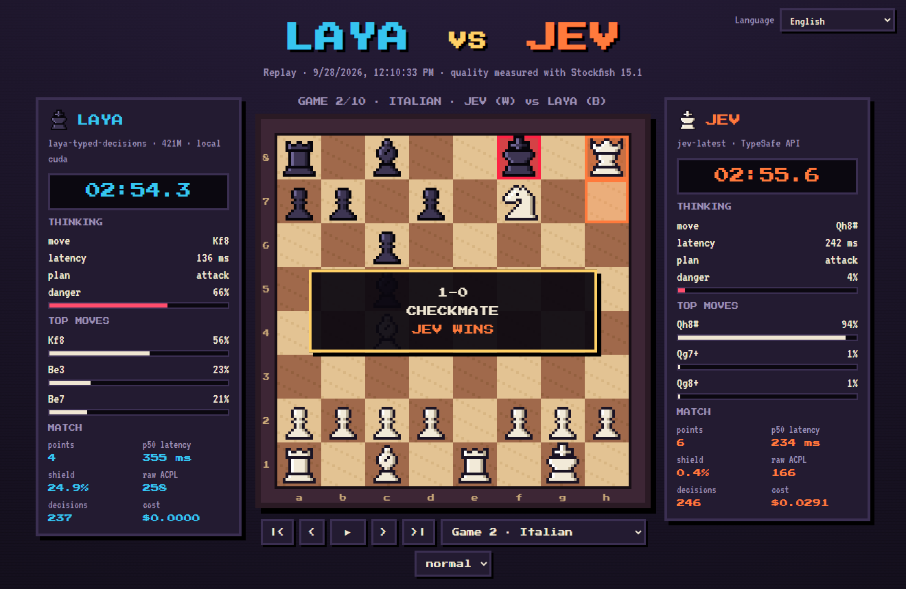

# ♞ Chess War · Laya vs Jev

[English](../README.md) · **Español** · [Français](README.fr.md) · [Русский](README.ru.md) · [中文](README.zh-CN.md) · [한국어](README.ko.md) · [日本語](README.ja.md) · [Português](README.pt-BR.md) · [Deutsch](README.de.md) · [Italiano](README.it.md)

Ajedrez pixel art entre dos modelos de decisión **System One** que reciben **exactamente las mismas preguntas tipadas**, turno tras turno. Inspirado en [doom-war](https://github.com/rythmn1111/doom-war), que enfrentó a estos mismos dos modelos en Doom.

**▶ Ver las repeticiones (10 idiomas): https://jhonsu01.github.io/chess-war/?lang=es**



| | **Laya** | **Jev** |
| --- | --- | --- |
| Tipo | pesos abiertos (Apache 2.0) | API alojada |
| Modelo | `laya-typed-decisions` · ModernBERT-large, 421M | `jev-1.13.0` |
| Dónde corre | contenedor Docker local, GPU NVIDIA | `api.typesafe.ai` |
| Precio | 0 $ | 0,042 $ por millón de tokens de entrada |

## Resultados

Se actualizan solos con `chess-war publish`. Latencia, escudo y ACPL se muestran como *Laya / Jev* (menos es mejor).

<!-- RESULTS:START -->
| Fecha | Match | Puntos | Latencia p50 | Escudo (OVERRIDDEN) | ACPL crudo | Coste | Repetición |
| --- | --- | --- | --- | --- | --- | --- | --- |
| 2026-09-28 | LAYA vs JEV | **4 – 6** | 355 ms / 234 ms | 24.9% / 0.4% | 258 / 166 | $0.0291 | [ver](https://jhonsu01.github.io/chess-war/?m=20260928-171033-laya-vs-jev&lang=es) |
<!-- RESULTS:END -->

### Primer match · 2026-09-28

- **Jev ganó 6–4** en 10 partidas: 2 victorias por mate, 8 tablas y ninguna derrota. Laya no ganó ninguna partida.
- **Jev fue más rápido**, incluso por internet: p50 de 234 ms frente a 355 ms de Laya en la GPU local. Cada turno hace ~15 preguntas y Laya ejecuta una pasada del encoder por pregunta.
- **Criterio:** el escudo tuvo que corregir el 24,9 % de las jugadas de Laya y el 0,4 % de las de Jev. ACPL crudo (Stockfish profundidad 12): Laya 258, Jev 166; errores graves de 300+ cp: 63 frente a 38.
- **Coste:** Jev gastó 0,029 $ en 694k tokens de entrada; Laya corrió gratis.
- **8 de 10 partidas acabaron por triple repetición:** los dos modelos son deterministas y repiten posiciones cuando nadie gana material. Además, Laya siguió paseando el rey en la apertura pese a la etiqueta `bad`.

## Cómo funciona

```
tablero ─► observe.py ─► schema.py ─────────► modelo ─► motor.py ────────────► jugada
           capturas,     preguntas tipadas,    Laya     decodificación conjunta
           piezas        el MISMO cuerpo       o Jev    + escudo determinista
           colgadas,     (POST /v1/systemone)
           mate (código) (código)                       (código)
```

- **El código calcula, el modelo juzga.** En cada turno `observe.py` hace un intercambio estático (SEE) a dos medias jugadas y detecta amenazas de mate en una. Las opciones ya dicen en palabras lo que sabe el cálculo: `good, wins a rook`, `terrible, rival can checkmate you`, `bad, king gives up castling`.
- **Una petición por turno** con el patrón *speculative fan-out* de TypeSafe: una pregunta `piece`, una `move_<casilla>` por cada pieza movible, más `plan` y `danger`. Los criterios de juego van en las `instructions`. Solo se ofrecen jugadas legales, así que las reglas del ajedrez no se pueden romper.
- **Mismo canal, mismos bytes.** Laya se sirve con `laya-serve`, que habla el mismo protocolo `POST /v1/systemone` que Jev. Solo cambia la URL.
- **La jugada** es la que el propio modelo considera más probable: `argmax P(pieza) × P(destino | pieza)`.
- **Escudo.** Una capa determinista veta solo lo que el código sabe que es un error: dejar mate en una, regalar material o tirar a tablas una posición ganada. Entonces juega la siguiente jugada sana del *mismo modelo*. El porcentaje de correcciones se publica como **OVERRIDDEN %**, igual que en doom-war.
- **Reloj.** 180 s por jugador, descontando la ida y vuelta completa (red incluida), así que la velocidad cuenta.
- **Justicia.** 10 aperturas fijas, cada una jugada dos veces con colores invertidos. A las 240 medias jugadas la partida se adjudica por material (gana quien lleve 3 puntos o más de ventaja).
- **Calidad.** Tras cada partida, Stockfish mide la pérdida en centipeones de la jugada que cada modelo *eligió* (ACPL crudo, antes del escudo) y de la que realmente se jugó.

## Calibración antes del match

Diez posiciones de prueba con respuesta conocida (`chess-war probe laya|jev`). La prueba también dio forma al diseño.

| Jugador | Aciertos | Latencia típica |
| --- | --- | --- |
| Jev `jev-1.13.0` | **10/10** | ~220 ms (por internet) |
| Laya `typed-decisions` | **7/10** | ~400 ms (RTX 3050 local) |

Lo que enseñó la prueba:

1. **Lectura literal.** Una opción decía `can win the queen` para una coronación, y los dos modelos la leyeron literalmente (no había dama que ganar). Ahora dice `good, promotes to a queen`.
2. **Amenaza omitida.** Ningún modelo se defendía de un mate que no estaba escrito en el estado. Ahora el estado dice `the rival threatens checkmate next move`.
3. **La palabra "king".** Laya daba 0,86 a `king on e8: bad: …` aunque decía *bad*. Quitar el nombre de la pieza de las opciones bajó ese sesgo de 0,56 a 0,09.
4. **Decodificación voraz frente a conjunta.** Elegir primero la pieza y luego la casilla favorecía a las piezas con muchas jugadas. La decodificación conjunta arregló los casos de coronación y defensa del mate para **ambos** modelos.
5. **Checkpoints.** De los tres checkpoints de Laya, `typed-decisions` fue el mejor (el multilingüe era el más rápido pero el menos preciso).

## Inicio rápido (Docker)

Necesitas Docker Desktop con soporte de GPU NVIDIA (también funciona en CPU, más lento) y una clave de la API de TypeSafe.

```bash
git clone https://github.com/jhonsu01/chess-war.git
cd chess-war
cp .env.example .env        # pon tu clave en TYPESAFE_API_KEY=
docker compose up -d --wait laya
docker compose run --rm --service-ports arena match --games 10 --exit
```

Abre **http://localhost:8080/?live&lang=es** para ver el match en vivo. Los resultados quedan en `results/<match-id>/` (`match.json`, `games.pgn`, `telemetry.jsonl`, `replay.json`).

**¿Dónde va la clave de la API?** En `.env`, como `TYPESAFE_API_KEY=...` (o en un archivo `jev.txt` que contenga solo la clave). Ambos archivos están en `.gitignore`.

Publicar un match en GitHub Pages y en todos los README:

```bash
chess-war publish results/<match-id>
git add docs README.md i18n && git commit -m "Publish match" && git push
```

## Ejecución nativa (arena sin Docker)

```bash
uv venv --python 3.12 && uv pip install -e ".[dev]"
chess-war check                 # comprueba Laya y Jev (claves, conexión, una decisión de prueba)
chess-war probe laya            # las 10 posiciones de calibración
chess-war match --games 10 --open
```

Stockfish es opcional en nativo (`--stockfish RUTA` o `STOCKFISH_PATH`); sin él se omite el ACPL.

| Comando / opción | Qué hace |
| --- | --- |
| `match --p1 laya --p2 jev` | jugadores: `laya`, `jev`, `lmstudio`, `random` |
| `--games 10` | número de partidas (pares con colores invertidos) |
| `--clock 180` | segundos por jugador; `0` desactiva el reloj |
| `--no-shield` | desactiva el escudo determinista |
| `--max-plies 240` | tope de medias jugadas antes de adjudicar por material |
| `--laya-checkpoint` | `english`, `multilingual` o `typed-decisions` |
| `--publish` | copia el resultado a `docs/` y actualiza los README |
| `view` | sirve `docs/` en local para ver repeticiones |

## Tercer jugador opcional: LM Studio

Un LLM generativo puede responder las mismas preguntas tipadas a través de la API compatible con OpenAI de LM Studio, restringido por un JSON Schema: `--p2 lmstudio` con `LMSTUDIO_URL`, `LMSTUDIO_API_KEY` y `LMSTUDIO_MODEL` en `.env`. No forma parte del match principal.

## Estructura del proyecto

```
chesswar/observe.py     tablero -> hechos tácticos (SEE, amenazas, mate en una)
chesswar/schema.py      hechos -> preguntas tipadas (idénticas para ambos)
chesswar/motor.py       respuestas -> jugada (decodificación conjunta + escudo)
chesswar/arena.py       partidas, reloj, telemetría, análisis con Stockfish
chesswar/backends/      jev.py, laya.py (mismo cliente HTTP), lmstudio.py, baseline.py
docs/                   visor pixel art (en vivo + repeticiones, 10 idiomas) = GitHub Pages
docker/                 laya.Dockerfile (laya-serve en CUDA), arena.Dockerfile (+ Stockfish)
```

## Créditos y licencias

- Código: GPL-3.0-or-later (usa [python-chess](https://github.com/niklasf/python-chess), GPL-3.0).
- [Laya](https://huggingface.co/convaiinnovations/laya) de Convai Innovations, Apache 2.0.
- [Jev](https://docs.typesafe.ai) de TypeSafe.
- [Stockfish](https://stockfishchess.org), GPL-3.0, instalado solo en la imagen del arena.
- Fuentes: Press Start 2P, VT323 y DotGothic16 (SIL Open Font License). Las piezas se dibujan en código.
- Idea: [rythmn1111/doom-war](https://github.com/rythmn1111/doom-war).
