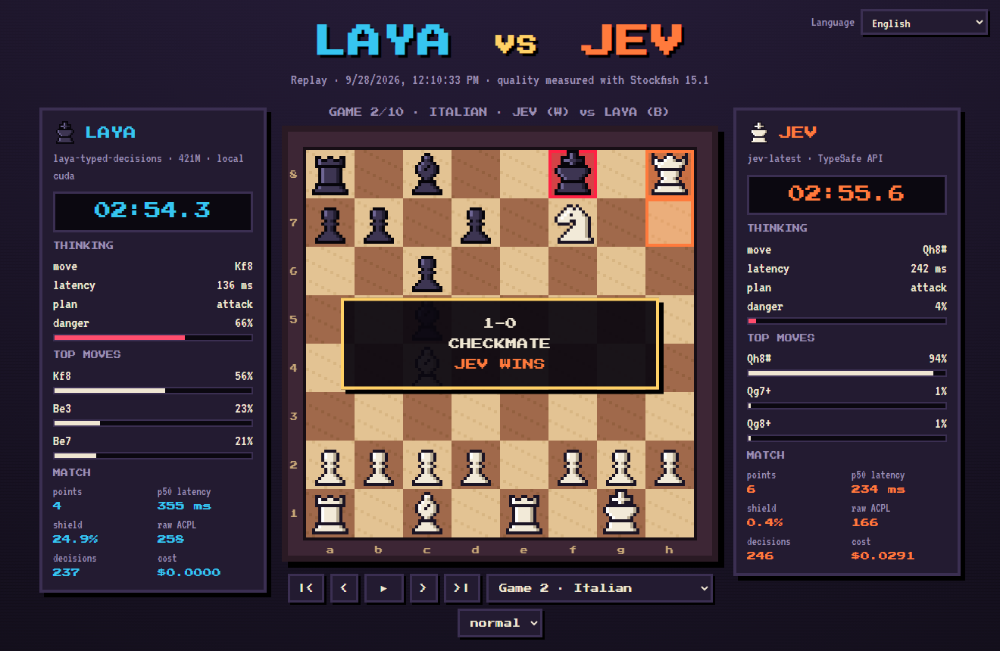

# ♞ Chess War · Laya vs Jev

[English](../README.md) · [Español](README.es.md) · **Français** · [Русский](README.ru.md) · [中文](README.zh-CN.md) · [한국어](README.ko.md) · [日本語](README.ja.md) · [Português](README.pt-BR.md) · [Deutsch](README.de.md) · [Italiano](README.it.md)

Des échecs en pixel art entre deux modèles de décision **System One** qui reçoivent **exactement les mêmes questions typées**, tour après tour. Inspiré de [doom-war](https://github.com/rythmn1111/doom-war), qui opposait ces deux mêmes modèles dans Doom.

**▶ Voir les rediffusions (10 langues) : https://jhonsu01.github.io/chess-war/?lang=fr**



| | **Laya** | **Jev** |
| --- | --- | --- |
| Type | poids ouverts (Apache 2.0) | API hébergée |
| Modèle | `laya-typed-decisions` · ModernBERT-large, 421M | `jev-1.13.0` |
| Tourne sur | conteneur Docker local, GPU NVIDIA | `api.typesafe.ai` |
| Prix | 0 $ | 0,042 $ par million de tokens d'entrée |

## Résultats

Mis à jour automatiquement par `chess-war publish`. Latence, bouclier et ACPL sont affichés sous la forme *Laya / Jev* (plus bas = mieux).

<!-- RESULTS:START -->
| Date | Match | Points | Latence p50 | Bouclier (OVERRIDDEN) | ACPL brut | Coût | Rediffusion |
| --- | --- | --- | --- | --- | --- | --- | --- |
| 2026-09-28 | LAYA vs JEV | **4 – 6** | 355 ms / 234 ms | 24.9% / 0.4% | 258 / 166 | $0.0291 | [voir](https://jhonsu01.github.io/chess-war/?m=20260928-171033-laya-vs-jev&lang=fr) |
<!-- RESULTS:END -->

### Premier match · 2026-09-28

- **Jev a gagné 6–4** en 10 parties : 2 victoires par mat, 8 nulles, aucune défaite. Laya n'a gagné aucune partie.
- **Jev a été plus rapide**, même via Internet : p50 de 234 ms contre 355 ms pour Laya sur le GPU local. Chaque tour pose ~15 questions et Laya fait une passe d'encodeur par question.
- **Jugement :** le bouclier a dû corriger 24,9 % des coups de Laya et 0,4 % de ceux de Jev. ACPL brut (Stockfish profondeur 12) : Laya 258, Jev 166 ; gaffes de 300+ cp : 63 contre 38.
- **Coût :** Jev a dépensé 0,029 $ pour 694k tokens d'entrée ; Laya a tourné gratuitement.
- **8 parties sur 10 se sont terminées par triple répétition :** les deux modèles sont déterministes et répètent les positions quand personne ne gagne de matériel. Laya a aussi continué à promener son roi dans l'ouverture malgré l'étiquette `bad`.

## Comment ça marche

```
échiquier ─► observe.py ─► schema.py ─────────► modèle ─► motor.py ───────────► coup
             captures,     questions typées,     Laya     décodage conjoint
             pièces en     MÊME corps pour       ou Jev   + bouclier déterministe
             prise, mat    les deux (POST /v1/systemone)
             (code)        (code)                          (code)
```

- **Le code calcule, le modèle juge.** À chaque tour, `observe.py` effectue une évaluation statique des échanges (SEE) sur deux demi-coups et détecte les menaces de mat en un. Les options disent déjà en mots ce que sait le calcul : `good, wins a rook`, `terrible, rival can checkmate you`, `bad, king gives up castling`.
- **Une requête par tour** avec le motif *speculative fan-out* de TypeSafe : une question `piece`, une question `move_<case>` par pièce mobile, plus `plan` et `danger`. Les critères de jeu vont dans les `instructions`. Seuls des coups légaux sont proposés, donc les règles des échecs ne peuvent pas être enfreintes.
- **Même canal, mêmes octets.** Laya est servi par `laya-serve`, qui parle le même protocole `POST /v1/systemone` que Jev. Seule l'URL change.
- **Le coup joué** est celui que le modèle lui-même juge le plus probable : `argmax P(pièce) × P(destination | pièce)`.
- **Bouclier.** Une couche déterministe ne bloque que ce que le code sait être une erreur : laisser un mat en un, donner du matériel ou gâcher une position gagnante en nulle. Il joue alors le coup sain suivant du *même modèle*. La proportion de coups corrigés est publiée comme **OVERRIDDEN %**, comme dans doom-war.
- **Pendule.** 180 s par joueur, décomptées sur l'aller-retour complet (réseau compris) : la vitesse compte.
- **Équité.** 10 ouvertures fixes, chacune jouée deux fois en inversant les couleurs. Après 240 demi-coups, la partie est adjugée au matériel (une avance de 3 points ou plus gagne).
- **Qualité.** Après chaque partie, Stockfish mesure la perte en centipions du coup que chaque modèle a *choisi* (ACPL brut, avant le bouclier) et du coup réellement joué.

## Calibration avant le match

Dix positions de test à réponse connue (`chess-war probe laya|jev`). Le test a aussi façonné la conception.

| Joueur | Score | Latence typique |
| --- | --- | --- |
| Jev `jev-1.13.0` | **10/10** | ~220 ms (via Internet) |
| Laya `typed-decisions` | **7/10** | ~400 ms (RTX 3050 locale) |

Ce que le test nous a appris :

1. **Lecture littérale.** Une option disait `can win the queen` pour une promotion ; les deux modèles l'ont lue au pied de la lettre (il n'y avait aucune dame à gagner). Elle dit maintenant `good, promotes to a queen`.
2. **Menace absente.** Aucun modèle ne parait une menace de mat qui n'était pas écrite dans l'état. L'état dit maintenant `the rival threatens checkmate next move`.
3. **Le mot « king ».** Laya donnait 0,86 à `king on e8: bad: …` alors que l'option disait *bad*. Retirer le nom de la pièce des options a réduit ce biais de 0,56 à 0,09.
4. **Décodage glouton ou conjoint.** Choisir d'abord la pièce puis sa case favorisait les pièces ayant beaucoup de coups. Le décodage conjoint a corrigé les cas de promotion et de défense contre le mat pour **les deux** modèles.
5. **Checkpoints.** Parmi les trois checkpoints de Laya, `typed-decisions` a obtenu le meilleur score (le multilingue était le plus rapide mais le moins précis).

## Démarrage rapide (Docker)

Il vous faut Docker Desktop avec prise en charge GPU NVIDIA (le CPU fonctionne aussi, plus lentement) et une clé d'API TypeSafe.

```bash
git clone https://github.com/jhonsu01/chess-war.git
cd chess-war
cp .env.example .env        # mettez votre clé dans TYPESAFE_API_KEY=
docker compose up -d --wait laya
docker compose run --rm --service-ports arena match --games 10 --exit
```

Ouvrez **http://localhost:8080/?live&lang=fr** pour suivre le match en direct. Les résultats arrivent dans `results/<match-id>/` (`match.json`, `games.pgn`, `telemetry.jsonl`, `replay.json`).

**Où mettre la clé d'API ?** Dans `.env`, sous la forme `TYPESAFE_API_KEY=...` (ou dans un fichier `jev.txt` qui ne contient que la clé). Les deux fichiers sont ignorés par git.

Publier un match sur GitHub Pages et dans tous les README :

```bash
chess-war publish results/<match-id>
git add docs README.md i18n && git commit -m "Publish match" && git push
```

## Exécution native (arène sans Docker)

```bash
uv venv --python 3.12 && uv pip install -e ".[dev]"
chess-war check                 # vérifie Laya et Jev (clés, accessibilité, une décision de test)
chess-war probe laya            # les 10 positions de calibration
chess-war match --games 10 --open
```

Stockfish est facultatif en natif (`--stockfish CHEMIN` ou `STOCKFISH_PATH`) ; sans lui, l'ACPL est ignoré.

| Commande / option | Rôle |
| --- | --- |
| `match --p1 laya --p2 jev` | joueurs : `laya`, `jev`, `lmstudio`, `random` |
| `--games 10` | nombre de parties (paires avec couleurs inversées) |
| `--clock 180` | secondes par joueur ; `0` désactive la pendule |
| `--no-shield` | désactive le bouclier déterministe |
| `--max-plies 240` | plafond de demi-coups avant l'adjudication au matériel |
| `--laya-checkpoint` | `english`, `multilingual` ou `typed-decisions` |
| `--publish` | copie le résultat dans `docs/` et met à jour les README |
| `view` | sert `docs/` en local pour parcourir les rediffusions |

## Troisième joueur facultatif : LM Studio

Un LLM génératif peut répondre aux mêmes questions typées via l'API compatible OpenAI de LM Studio, contraint par un JSON Schema : `--p2 lmstudio` avec `LMSTUDIO_URL`, `LMSTUDIO_API_KEY` et `LMSTUDIO_MODEL` dans `.env`. Il ne fait pas partie du match principal.

## Organisation du projet

```
chesswar/observe.py     échiquier -> faits tactiques (SEE, menaces, mat en un)
chesswar/schema.py      faits -> questions typées (identiques pour les deux joueurs)
chesswar/motor.py       réponses -> coup (décodage conjoint + bouclier)
chesswar/arena.py       parties, pendule, télémétrie, analyse Stockfish
chesswar/backends/      jev.py, laya.py (même client HTTP), lmstudio.py, baseline.py
docs/                   visionneuse pixel art (direct + rediffusions, 10 langues) = GitHub Pages
docker/                 laya.Dockerfile (laya-serve sur CUDA), arena.Dockerfile (+ Stockfish)
```

## Crédits et licences

- Code : GPL-3.0-or-later (il utilise [python-chess](https://github.com/niklasf/python-chess), GPL-3.0).
- [Laya](https://huggingface.co/convaiinnovations/laya) par Convai Innovations, Apache 2.0.
- [Jev](https://docs.typesafe.ai) par TypeSafe.
- [Stockfish](https://stockfishchess.org), GPL-3.0, installé uniquement dans l'image de l'arène.
- Polices : Press Start 2P, VT323 et DotGothic16 (SIL Open Font License). Les pièces sont dessinées en code.
- Idée : [rythmn1111/doom-war](https://github.com/rythmn1111/doom-war).
