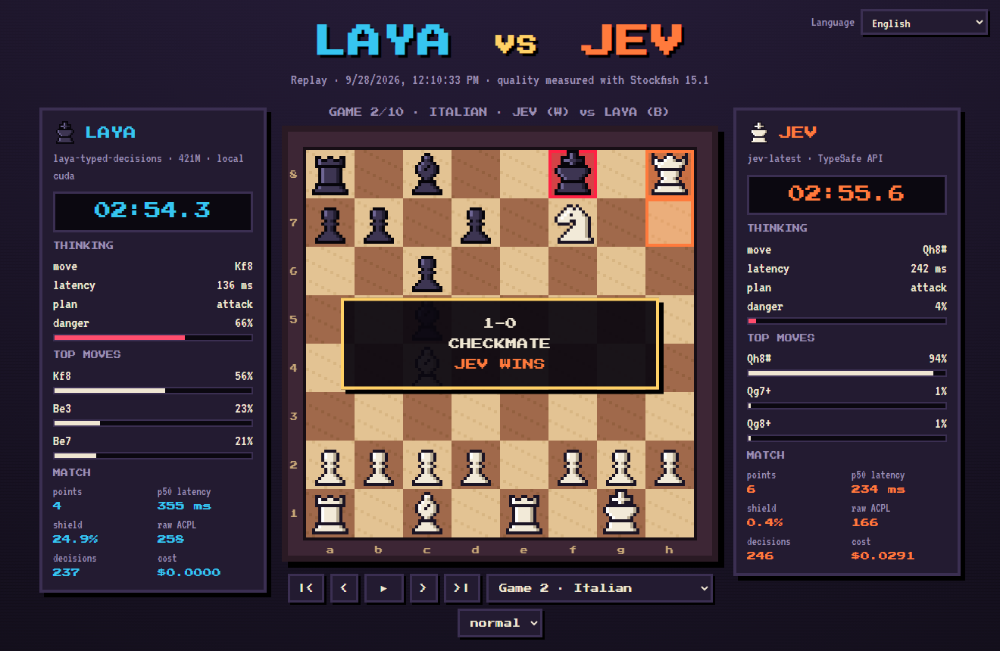

# ♞ Chess War · Laya vs Jev

[English](../README.md) · [Español](README.es.md) · [Français](README.fr.md) · [Русский](README.ru.md) · [中文](README.zh-CN.md) · [한국어](README.ko.md) · [日本語](README.ja.md) · [Português](README.pt-BR.md) · [Deutsch](README.de.md) · **Italiano**

Scacchi in pixel art tra due modelli decisionali **System One** che ricevono, mossa dopo mossa, **esattamente le stesse domande tipizzate**. Ispirato a [doom-war](https://github.com/rythmn1111/doom-war), che ha messo gli stessi due modelli uno contro l'altro in Doom.

**▶ Guarda i replay (10 lingue): https://jhonsu01.github.io/chess-war/?lang=it**



| | **Laya** | **Jev** |
| --- | --- | --- |
| Tipo | pesi aperti (Apache 2.0) | API ospitata |
| Modello | `laya-typed-decisions` · ModernBERT-large, 421M | `jev-1.13.0` |
| Dove gira | container Docker locale, GPU NVIDIA | `api.typesafe.ai` |
| Prezzo | 0 $ | 0,042 $ per milione di token in ingresso |

## Risultati

Aggiornati automaticamente da `chess-war publish`. Latenza, scudo e ACPL sono mostrati come *Laya / Jev* (più basso è meglio).

<!-- RESULTS:START -->
| Data | Match | Punti | Latenza p50 | Scudo (OVERRIDDEN) | ACPL grezzo | Costo | Replay |
| --- | --- | --- | --- | --- | --- | --- | --- |
| 2026-09-28 | LAYA vs JEV | **4 – 6** | 355 ms / 234 ms | 24.9% / 0.4% | 258 / 166 | $0.0291 | [guarda](https://jhonsu01.github.io/chess-war/?m=20260928-171033-laya-vs-jev&lang=it) |
<!-- RESULTS:END -->

### Primo match · 2026-09-28

- **Jev ha vinto 6–4** su 10 partite: 2 vittorie per scacco matto, 8 patte, nessuna sconfitta. Laya non ha vinto nessuna partita.
- **Jev è stato più veloce**, pur passando da Internet: p50 di 234 ms contro 355 ms di Laya sulla GPU locale. Ogni mossa pone ~15 domande e Laya esegue un passaggio dell'encoder per ciascuna.
- **Giudizio:** lo scudo ha dovuto correggere il 24,9% delle mosse di Laya e lo 0,4% di quelle di Jev. ACPL grezzo (Stockfish profondità 12): Laya 258, Jev 166; errori gravi da 300+ cp: 63 contro 38.
- **Costo:** Jev ha speso 0,029 $ per 694k token in ingresso; Laya ha girato gratis.
- **8 partite su 10 sono finite per triplice ripetizione:** entrambi i modelli sono deterministici e ripetono le posizioni quando nessuno guadagna materiale. Inoltre Laya ha continuato a muovere il re in apertura nonostante l'etichetta `bad`.

## Come funziona

```
scacchiera ─► observe.py ─► schema.py ────────► modello ─► motor.py ─────────► mossa
              catture,      domande tipizzate,   Laya      decodifica congiunta
              pezzi in      lo STESSO corpo      o Jev     + scudo deterministico
              presa, matto  (POST /v1/systemone)
              (codice)      (codice)                        (codice)
```

- **Il codice calcola, il modello giudica.** A ogni mossa `observe.py` esegue una valutazione statica degli scambi (SEE) profonda due semimosse e rileva le minacce di matto in una. Le opzioni dicono già a parole ciò che il calcolo sa: `good, wins a rook`, `terrible, rival can checkmate you`, `bad, king gives up castling`.
- **Una richiesta per mossa** con lo schema *speculative fan-out* di TypeSafe: una domanda `piece`, una domanda `move_<casa>` per ogni pezzo che può muovere, più `plan` e `danger`. I criteri di gioco stanno nelle `instructions`. Vengono proposte solo mosse legali, quindi le regole degli scacchi non si possono violare.
- **Stesso canale, stessi byte.** Laya è servita da `laya-serve`, che parla lo stesso protocollo `POST /v1/systemone` di Jev. Cambia solo l'URL.
- **La mossa giocata** è quella che il modello stesso ritiene più probabile: `argmax P(pezzo) × P(destinazione | pezzo)`.
- **Scudo.** Uno strato deterministico blocca solo ciò che il codice sa essere un errore: concedere matto in una, regalare materiale o buttare via una posizione vinta pattando. Poi gioca la successiva mossa sensata dello *stesso modello*. La quota di mosse corrette è pubblicata come **OVERRIDDEN %**, come in doom-war.
- **Orologio.** 180 s per giocatore, calcolati sull'intero andata e ritorno (rete inclusa): la velocità conta.
- **Equità.** 10 aperture fisse, ognuna giocata due volte a colori invertiti. Dopo 240 semimosse la partita viene aggiudicata sul materiale (vince un vantaggio di 3 punti o più).
- **Qualità.** Dopo ogni partita Stockfish misura la perdita in centipedoni della mossa che ogni modello ha *scelto* (ACPL grezzo, prima dello scudo) e di quella effettivamente giocata.

## Calibrazione prima del match

Dieci posizioni di prova con risposta nota (`chess-war probe laya|jev`). Il test ha anche plasmato il progetto.

| Giocatore | Punteggio | Latenza tipica |
| --- | --- | --- |
| Jev `jev-1.13.0` | **10/10** | ~220 ms (via Internet) |
| Laya `typed-decisions` | **7/10** | ~400 ms (RTX 3050 locale) |

Cosa ci ha insegnato il test:

1. **Lettura letterale.** Un'opzione diceva `can win the queen` per una promozione; entrambi i modelli l'hanno presa alla lettera (non c'era nessuna donna da vincere). Ora dice `good, promotes to a queen`.
2. **Minaccia assente.** Nessuno dei due modelli si difendeva da una minaccia di matto non scritta nello stato. Ora lo stato dice `the rival threatens checkmate next move`.
3. **La parola "king".** Laya dava 0,86 a `king on e8: bad: …` anche se diceva *bad*. Togliere il nome del pezzo dalle opzioni ha ridotto questa distorsione da 0,56 a 0,09.
4. **Decodifica avida o congiunta.** Scegliere prima il pezzo e poi la casa favoriva i pezzi con molte mosse. La decodifica congiunta ha corretto i casi di promozione e di difesa dal matto per **entrambi** i modelli.
5. **Checkpoint.** Tra i tre checkpoint di Laya, `typed-decisions` ha ottenuto il punteggio migliore (quello multilingue era il più veloce ma il meno preciso).

## Avvio rapido (Docker)

Servono Docker Desktop con supporto GPU NVIDIA (funziona anche su CPU, più lentamente) e una chiave API di TypeSafe.

```bash
git clone https://github.com/jhonsu01/chess-war.git
cd chess-war
cp .env.example .env        # metti la tua chiave in TYPESAFE_API_KEY=
docker compose up -d --wait laya
docker compose run --rm --service-ports arena match --games 10 --exit
```

Apri **http://localhost:8080/?live&lang=it** per seguire il match in diretta. I risultati finiscono in `results/<match-id>/` (`match.json`, `games.pgn`, `telemetry.jsonl`, `replay.json`).

**Dove va la chiave API?** In `.env`, come `TYPESAFE_API_KEY=...` (oppure in un file `jev.txt` che contiene solo la chiave). Entrambi i file sono ignorati da git.

Pubblicare un match su GitHub Pages e in tutti i README:

```bash
chess-war publish results/<match-id>
git add docs README.md i18n && git commit -m "Publish match" && git push
```

## Esecuzione nativa (arena senza Docker)

```bash
uv venv --python 3.12 && uv pip install -e ".[dev]"
chess-war check                 # controlla Laya e Jev (chiavi, raggiungibilità, una decisione di prova)
chess-war probe laya            # le 10 posizioni di calibrazione
chess-war match --games 10 --open
```

In esecuzione nativa Stockfish è facoltativo (`--stockfish PERCORSO` o `STOCKFISH_PATH`); senza, l'ACPL viene saltato.

| Comando / opzione | Cosa fa |
| --- | --- |
| `match --p1 laya --p2 jev` | giocatori: `laya`, `jev`, `lmstudio`, `random` |
| `--games 10` | numero di partite (coppie a colori invertiti) |
| `--clock 180` | secondi per giocatore; `0` disattiva l'orologio |
| `--no-shield` | disattiva lo scudo deterministico |
| `--max-plies 240` | limite di semimosse prima dell'aggiudicazione sul materiale |
| `--laya-checkpoint` | `english`, `multilingual` o `typed-decisions` |
| `--publish` | copia il risultato in `docs/` e aggiorna i README |
| `view` | serve `docs/` in locale per sfogliare i replay |

## Terzo giocatore facoltativo: LM Studio

Un LLM generativo può rispondere alle stesse domande tipizzate tramite l'API compatibile con OpenAI di LM Studio, vincolato da uno JSON Schema: `--p2 lmstudio` con `LMSTUDIO_URL`, `LMSTUDIO_API_KEY` e `LMSTUDIO_MODEL` in `.env`. Non fa parte del match principale.

## Struttura del progetto

```
chesswar/observe.py     scacchiera -> fatti tattici (SEE, minacce, matto in una)
chesswar/schema.py      fatti -> domande tipizzate (identiche per entrambi)
chesswar/motor.py       risposte -> mossa (decodifica congiunta + scudo)
chesswar/arena.py       partite, orologio, telemetria, analisi con Stockfish
chesswar/backends/      jev.py, laya.py (stesso client HTTP), lmstudio.py, baseline.py
docs/                   visualizzatore pixel art (diretta + replay, 10 lingue) = GitHub Pages
docker/                 laya.Dockerfile (laya-serve su CUDA), arena.Dockerfile (+ Stockfish)
```

## Crediti e licenze

- Codice: GPL-3.0-or-later (usa [python-chess](https://github.com/niklasf/python-chess), GPL-3.0).
- [Laya](https://huggingface.co/convaiinnovations/laya) di Convai Innovations, Apache 2.0.
- [Jev](https://docs.typesafe.ai) di TypeSafe.
- [Stockfish](https://stockfishchess.org), GPL-3.0, installato solo nell'immagine dell'arena.
- Font: Press Start 2P, VT323 e DotGothic16 (SIL Open Font License). I pezzi sono disegnati nel codice.
- Idea: [rythmn1111/doom-war](https://github.com/rythmn1111/doom-war).
