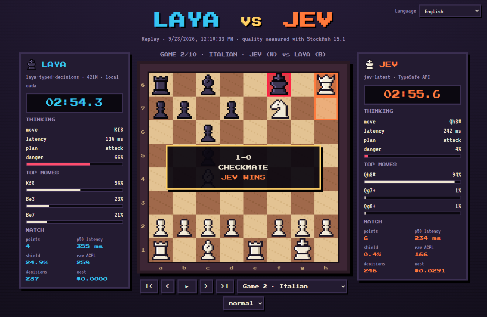

# ♞ Chess War · Laya vs Jev

[English](../README.md) · [Español](README.es.md) · [Français](README.fr.md) · [Русский](README.ru.md) · [中文](README.zh-CN.md) · [한국어](README.ko.md) · **日本語** · [Português](README.pt-BR.md) · [Deutsch](README.de.md) · [Italiano](README.it.md)

2つの **System One** 意思決定モデルが、毎手**まったく同じ型付き質問**を受け取って指すピクセルアートのチェスです。同じ2つのモデルを Doom で対戦させた [doom-war](https://github.com/rythmn1111/doom-war) に着想を得ています。

**▶ リプレイを見る（10言語）: https://jhonsu01.github.io/chess-war/?lang=ja**



| | **Laya** | **Jev** |
| --- | --- | --- |
| 種類 | オープンウェイト（Apache 2.0） | ホスト型 API |
| モデル | `laya-typed-decisions` · ModernBERT-large、421M | `jev-1.13.0` |
| 実行場所 | ローカルの Docker コンテナ、NVIDIA GPU | `api.typesafe.ai` |
| 価格 | 0 ドル | 入力トークン100万あたり 0.042 ドル |

## 結果

`chess-war publish` が自動で更新します。レイテンシ、シールド、ACPL は *Laya / Jev* の形式で表示します（低いほど良い）。

<!-- RESULTS:START -->
| 日付 | 対局 | ポイント | p50 レイテンシ | シールド (OVERRIDDEN) | 生 ACPL | コスト | リプレイ |
| --- | --- | --- | --- | --- | --- | --- | --- |
| 2026-09-28 | LAYA vs JEV | **4 – 6** | 355 ms / 234 ms | 24.9% / 0.4% | 258 / 166 | $0.0291 | [見る](https://jhonsu01.github.io/chess-war/?m=20260928-171033-laya-vs-jev&lang=ja) |
<!-- RESULTS:END -->

### 第1回対局 · 2026-09-28

- **Jev が10局で6–4 の勝利**：チェックメイト2勝、引き分け8、負けなし。Laya は1局も勝てませんでした。
- **Jev の方が速かった**（インターネット経由なのに）：p50 は 234 ms、ローカル GPU の Laya は 355 ms。毎手およそ15の質問があり、Laya は質問ごとにエンコーダを1回実行します。
- **判断の質：** シールドは Laya の手の 24.9%、Jev の手の 0.4% を修正する必要がありました。生 ACPL（Stockfish 深さ12）：Laya 258、Jev 166。300cp 以上の大悪手：63 対 38。
- **コスト：** Jev は入力トークン 69.4万で 0.029 ドル。Laya は無料で動きました。
- **10局中8局が3回同形で終了：** 両モデルとも決定論的なので、どちらも駒得できないと局面を繰り返します。また Laya は `bad` のラベルがあってもオープニングでキングを動かし続けました。

## 仕組み

```
盤面 ─► observe.py ─► schema.py ──────────► モデル ─► motor.py ─────────► 指し手
        駒取り、        型付き質問、          Laya     結合デコード
        浮き駒、メイト  両者に同じリクエスト  または Jev + 決定論的シールド
        （コード）      (POST /v1/systemone)           （コード）
```

- **計算はコード、判断はモデル。** 毎手 `observe.py` が2プライ深さの静的交換評価（SEE）を行い、1手メイトの脅威を検出します。選択肢には計算でわかったことがすでに言葉で書かれています：`good, wins a rook`、`terrible, rival can checkmate you`、`bad, king gives up castling`。
- **1手につき1リクエスト。** TypeSafe の *speculative fan-out* パターンを使います：`piece` の質問が1つ、動かせる駒ごとに `move_<マス>` の質問が1つ、さらに `plan` と `danger`。指し方の基準は `instructions` に入っています。合法手しか提示しないので、チェスのルールを破ることはできません。
- **同じ通路、同じバイト列。** Laya は Jev と同じ `POST /v1/systemone` プロトコルを話す `laya-serve` で提供されます。違うのは URL だけです。
- **実際に指す手**は、モデル自身が最も確率が高いとした手です：`argmax P(駒) × P(移動先 | 駒)`。
- **シールド。** 決定論的な層が、コードが確実に悪手とわかるもの（1手メイトを許す、駒をただで渡す、勝ちの局面を引き分けにする）だけを拒否し、*同じモデル*の次に妥当な手を指します。修正された手の割合は doom-war と同じく **OVERRIDDEN %** として公開されます。
- **持ち時間。** 1人180秒。ネットワークを含む往復時間全体が差し引かれるので、速さが重要です。
- **公平性。** 10個の固定オープニングを、色を入れ替えて2回ずつ指します。240プライを超えると駒の損得で判定します（3点以上リードで勝ち）。
- **品質。** 各対局の後、Stockfish が各モデルが*選んだ*手（生 ACPL、シールド前）と実際に指された手のセンチポーン損失を計測します。

## 対局前のキャリブレーション

答えがわかっている10個のテスト局面（`chess-war probe laya|jev`）。このテストは設計にも影響を与えました。

| プレイヤー | スコア | 典型的なレイテンシ |
| --- | --- | --- |
| Jev `jev-1.13.0` | **10/10** | 約220 ms（インターネット経由） |
| Laya `typed-decisions` | **7/10** | 約400 ms（ローカル RTX 3050） |

テストからわかったこと：

1. **文字どおりの解釈。** 昇格の選択肢に `can win the queen` と書いたところ、両モデルとも文字どおりに受け取りました（取れるクイーンはありませんでした）。現在は `good, promotes to a queen` と書いています。
2. **書かれていない脅威。** 状態に書かれていないメイトの脅威は、どちらのモデルも防げませんでした。現在は状態に `the rival threatens checkmate next move` が入ります。
3. **「king」という単語。** Laya は *bad* と書かれていても `king on e8: bad: …` に 0.86 を与えていました。選択肢から駒の名前を外すと、この偏りは 0.56 から 0.09 に下がりました。
4. **貪欲デコードと結合デコード。** 先に駒、次にマスを選ぶと、手の多い駒が有利になっていました。結合デコードにより、**両方**のモデルで昇格とメイト防御のケースが直りました。
5. **チェックポイント。** Laya の3つのチェックポイントのうち `typed-decisions` が最も良い結果でした（多言語版は最速ですが最も不正確）。

## クイックスタート（Docker）

NVIDIA GPU に対応した Docker Desktop（CPU でも動きますが遅くなります）と TypeSafe の API キーが必要です。

```bash
git clone https://github.com/jhonsu01/chess-war.git
cd chess-war
cp .env.example .env        # TYPESAFE_API_KEY= にキーを入れる
docker compose up -d --wait laya
docker compose run --rm --service-ports arena match --games 10 --exit
```

**http://localhost:8080/?live&lang=ja** を開くと対局をライブで観戦できます。結果は `results/<match-id>/`（`match.json`、`games.pgn`、`telemetry.jsonl`、`replay.json`）に保存されます。

**API キーはどこに置く？** `.env` に `TYPESAFE_API_KEY=...` として書きます（またはキーだけを書いた `jev.txt` ファイル）。どちらも git の対象外です。

対局を GitHub Pages とすべての README に公開する：

```bash
chess-war publish results/<match-id>
git add docs README.md i18n && git commit -m "Publish match" && git push
```

## ネイティブ実行（アリーナを Docker なしで）

```bash
uv venv --python 3.12 && uv pip install -e ".[dev]"
chess-war check                 # Laya と Jev を確認（キー、接続、テスト判断1回）
chess-war probe laya            # キャリブレーション用の10局面
chess-war match --games 10 --open
```

ネイティブ実行では Stockfish は任意です（`--stockfish パス` または `STOCKFISH_PATH`）。ない場合は ACPL をスキップします。

| コマンド / オプション | 内容 |
| --- | --- |
| `match --p1 laya --p2 jev` | プレイヤー：`laya`、`jev`、`lmstudio`、`random` |
| `--games 10` | 対局数（色を入れ替えたペア） |
| `--clock 180` | 1人あたりの秒数；`0` で持ち時間なし |
| `--no-shield` | 決定論的シールドを無効化 |
| `--max-plies 240` | 駒の損得で判定する前のプライ上限 |
| `--laya-checkpoint` | `english`、`multilingual`、`typed-decisions` |
| `--publish` | 結果を `docs/` にコピーし README を更新 |
| `view` | リプレイ閲覧用に `docs/` をローカルで配信 |

## 任意の3人目のプレイヤー：LM Studio

生成系 LLM も LM Studio の OpenAI 互換 API を通じ、JSON Schema の制約のもとで同じ型付き質問に答えられます：`.env` に `LMSTUDIO_URL`、`LMSTUDIO_API_KEY`、`LMSTUDIO_MODEL` を設定して `--p2 lmstudio` を使います。メインの対局には含まれません。

## プロジェクト構成

```
chesswar/observe.py     盤面 -> 戦術的な事実（SEE、脅威、1手メイト）
chesswar/schema.py      事実 -> 型付き質問（両プレイヤーで同一）
chesswar/motor.py       回答 -> 指し手（結合デコード + シールド）
chesswar/arena.py       対局、持ち時間、テレメトリ、Stockfish 解析
chesswar/backends/      jev.py、laya.py（同じ HTTP クライアント）、lmstudio.py、baseline.py
docs/                   ピクセルアートのビューア（ライブ + リプレイ、10言語）= GitHub Pages
docker/                 laya.Dockerfile（CUDA 上の laya-serve）、arena.Dockerfile（+ Stockfish）
```

## クレジットとライセンス

- コード：GPL-3.0-or-later（[python-chess](https://github.com/niklasf/python-chess)、GPL-3.0 を使用）。
- [Laya](https://huggingface.co/convaiinnovations/laya)、Convai Innovations、Apache 2.0。
- [Jev](https://docs.typesafe.ai)、TypeSafe。
- [Stockfish](https://stockfishchess.org)、GPL-3.0、アリーナのイメージにのみインストール。
- フォント：Press Start 2P、VT323、DotGothic16（SIL Open Font License）。駒はコードで描画しています。
- アイデア：[rythmn1111/doom-war](https://github.com/rythmn1111/doom-war)。
